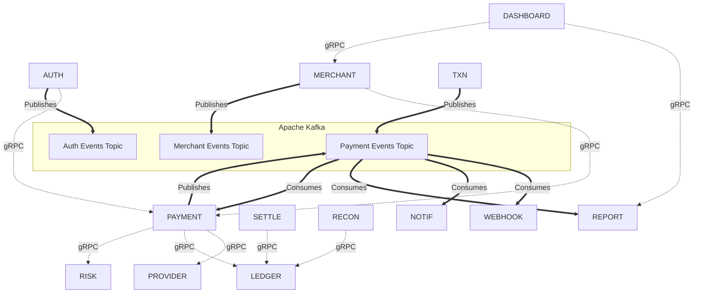
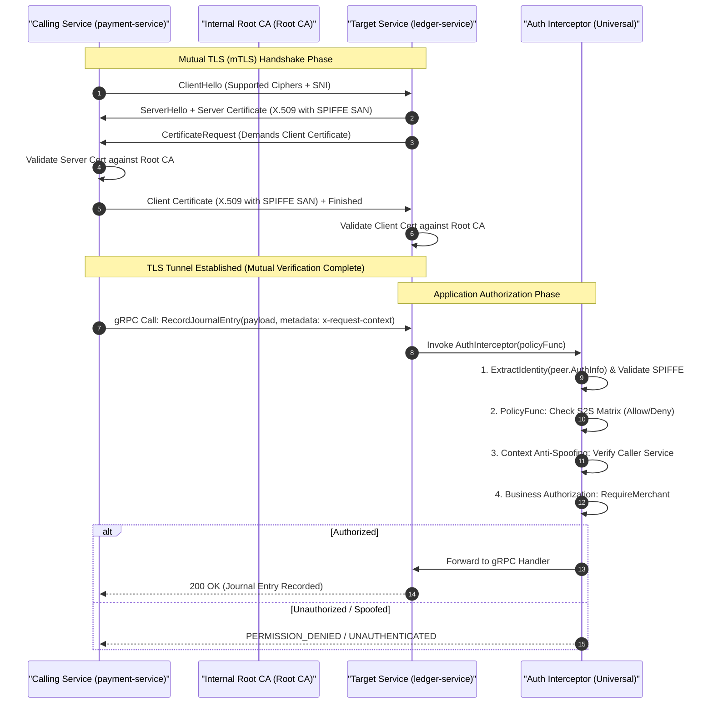
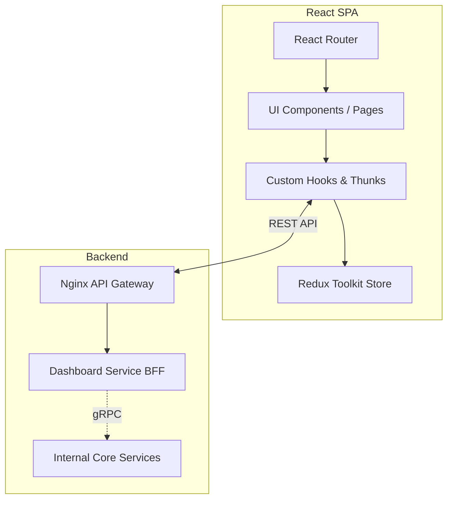
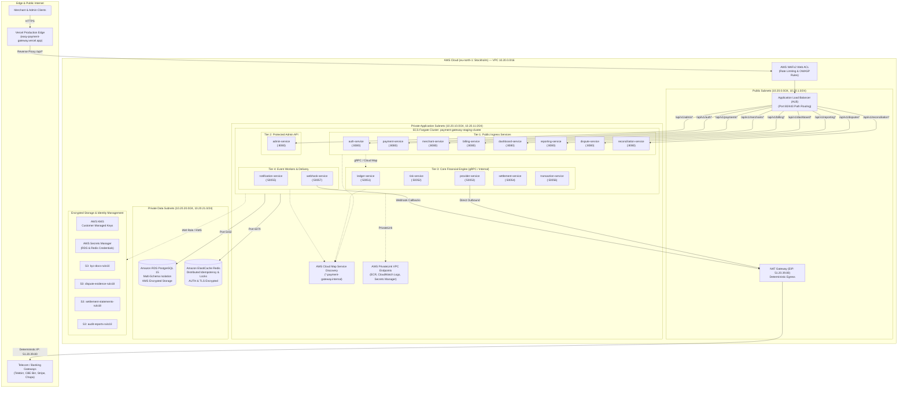
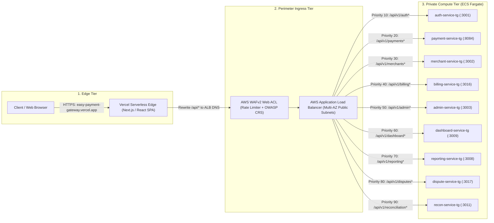
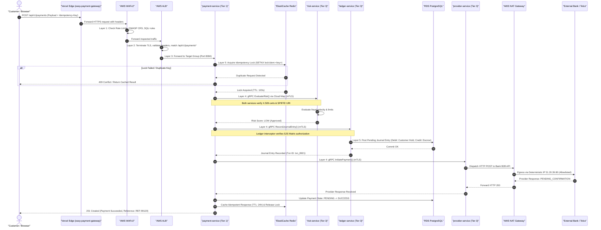

# Enterprise Payment Gateway


An enterprise-grade, highly resilient payment gateway designed for high-throughput financial transactions. This system is built on a polyglot microservice architecture featuring strictly consistent double-entry accounting, Zero-Trust network security, and asynchronous Kafka-based state orchestration to protect against external provider unreliability.

---

## 🏗 System Architecture Overview

The system is composed of **20 isolated microservices** routed through an Nginx Gateway. It is split into three technology stacks based on operational requirements: **Go** for high-performance financial core logic, **TypeScript/Express** for business management, and **Python** for machine learning inference.

```mermaid
flowchart TD
    CLIENTS[Clients / Merchants]
    GATEWAY[Nginx API Gateway]
    
    CLIENTS --> GATEWAY

    subgraph TS_Services ["Express/TypeScript Services (Business Layer)"]
        AUTH[Auth Service]
        MERCHANT[Merchant Service]
        ADMIN[Admin Service]
        DASHBOARD[Dashboard BFF]
        NOTIF[Notification Service]
        REPORT[Reporting Service]
        COMPLIANCE[Compliance Worker]
    end

    subgraph Go_Services ["Go Services (Financial Core)"]
        PAYMENT[Payment Service]
        PROVIDER[Provider Service]
        LEDGER[Ledger Service]
        TXN[Transaction Service]
        WEBHOOK[Webhook Service]
        RECON[Reconciliation Service]
        SETTLE[Settlement Service]
        RISK[Risk Service]
        ROUTING[Routing Service]
        PRICING[Pricing Service]
        DISPUTE[Dispute Service]
        FX[FX Service]
    end

    subgraph Python_Services ["Python Services (ML Layer)"]
        ML[Risk ML Worker]
    end

    GATEWAY --> AUTH
    GATEWAY --> MERCHANT
    GATEWAY --> PAYMENT
    GATEWAY --> TXN
    GATEWAY --> DASHBOARD
    GATEWAY --> ADMIN

    %% External Systems
    PROVIDER_EXT[External Providers e.g. Telebirr, CBE]
    PROVIDER <-->|API Calls| PROVIDER_EXT
    PROVIDER_EXT -->|Async Webhooks| TXN
```



### Technology Stack
*   **API Gateway**: Nginx 
*   **Business Services**: Node.js, Express, TypeScript, Prisma ORM
*   **Financial Core**: Go, gRPC, GORM
*   **Machine Learning**: Python, FastAPI/gRPC, scikit-learn
*   **Databases**: PostgreSQL (Microservice Database-per-service pattern)
*   **Message Broker**: Apache Kafka (Event-driven architecture & Outbox pattern)
*   **Caching**: Redis
*   **Observability**: OpenTelemetry, Prometheus, Grafana

---

## 🔄 Service-to-Service Communication

The gateway relies on two distinct communication patterns:
1.  **Synchronous (gRPC)**: For operations requiring immediate consistency (e.g., deducting limits, writing to the Ledger, checking risk rules).
2.  **Asynchronous (Kafka)**: For event broadcasting, long-running processes, and orchestrator loops.



---

## 💾 Database Architecture (Isolated Micro-Databases)

The system utilizes 20 isolated PostgreSQL schemas. **Each service completely owns its data** and no cross-database JOINs are permitted. Data replication and references are handled logically.

```mermaid
erDiagram
    "AUTH_DB" ||--o{ "Users" : manages
    "AUTH_DB" ||--o{ "Roles (RBAC)" : manages
    "AUTH_DB" ||--o{ "AuditLogs" : manages

    "MERCHANT_DB" ||--o{ "Merchants" : manages
    "MERCHANT_DB" ||--o{ "ApiKeys" : manages
    "MERCHANT_DB" ||--o{ "Limits & Prefs" : manages

    "PAYMENT_DB" ||--o{ "Payments" : manages
    "PAYMENT_DB" ||--o{ "Refunds" : manages
    "PAYMENT_DB" ||--o{ "PaymentStateHistory" : manages

    "LEDGER_DB" ||--o{ "JournalEntries" : manages
    "LEDGER_DB" ||--o{ "JournalLines" : manages
    "LEDGER_DB" ||--o{ "Accounts" : manages

    "TRANSACTION_DB" ||--o{ "ProviderWebhooks" : handles

    "WEBHOOK_DB" ||--o{ "Deliveries" : dispatches
    "WEBHOOK_DB" ||--o{ "Attempts" : tracks

    "ADMIN_DB" ||--o{ "PaymentProviders" : registers
    
    "RISK_DB" ||--o{ "FraudRules" : enforces
    "COMPLIANCE_DB" ||--o{ "KYC_Records" : tracks
    "PRICING_DB" ||--o{ "FeeSchedules" : calculates
    "ROUTING_DB" ||--o{ "RoutingRules" : determines
    "DISPUTE_DB" ||--o{ "Chargebacks" : manages
    "FX_DB" ||--o{ "ExchangeRates" : converts
```



### Key Schemas Detailed:
*   **`payment_db`**: Owns financial intent. Uses Optimistic Concurrency Control (OCC). Contains `Payments`, `Refunds`, `PaymentStateHistory`, and `IdempotencyKeys`.
*   **`ledger_db`**: The ultimate source of truth. Uses immutable **Double-Entry Accounting**. Entries can never be deleted or modified, only reversed.
*   **`merchant_db`**: Contains `Merchants`, `ApiKeys` (hashed), `WebhookConfigs`, `ProviderConfigs`, and detailed `MerchantPreferences` and `MerchantPaymentMethods`.
*   **`auth_db`**: Contains `Users`, `Credentials` (hashed), `Roles` (RBAC), and system-wide `AuditLogs`.
*   **`webhook_db`**: Handles outgoing webhooks to merchants. Uses `Deliveries` and `Attempts` tables to track exponential backoff and retries.

---

## 🛡 Security & Zero-Trust (mTLS & SPIFFE)

The system operates on an uncompromising **Zero-Trust** security model, assuming the internal VPC network is fundamentally untrusted. No service can communicate with another without cryptographic identity verification and method-level authorization.



### 1. Public Key Infrastructure (PKI) & Certificate Provisioning
Mutual TLS certificates are minted via automated scripts (`infra/scripts/generate-mtls.sh`) anchored by an internal Root Certificate Authority:
*   **Root CA**: 4096-bit RSA self-signed authority (`CN=PaymentGateway Root CA`), stored securely in private infrastructure and never exposed publicly.
*   **Service Certificates**: 2048-bit RSA keys minted individually for each microservice with dual Subject Alternative Names (SANs):
    1.  **DNS SAN**: `<service-name>.payment-gateway.internal` and `localhost` (enabling seamless resolution in both AWS Cloud Map and local testing).
    2.  **SPIFFE URI SAN**: Standardized identity string format:
        $$\text{spiffe://payment-gateway/ns/}\{\text{environment}\}\text{/sa/}\{\text{service-name}\}$$
        *(e.g., `spiffe://payment-gateway/ns/production/sa/payment-service`)*.

### 2. Reciprocal Wire Encryption & Handshake Verification
*   **Bidirectional Verification**: Unlike standard HTTPS where only the client verifies the server, mTLS requires the server to issue a `CertificateRequest`. Both sides must cryptographically prove possession of a private key signed by the shared Root CA.
*   **Cryptographic Wire Encryption**: Eliminates vulnerability to eavesdropping, packet sniffing, or man-in-the-middle attacks on the VPC network.

### 3. The 4-Phase Universal Interceptor Pipeline
All gRPC endpoints in Go (`packages/go-grpc-auth`) and TypeScript (`packages/ts-grpc-auth`) run an interceptor pipeline prior to handing execution to business logic:

1.  **Phase 1: Cryptographic Identity Extraction (`ExtractIdentity`)**:
    Inspects `peer.AuthInfo`, validates the certificate chain against the trust bundle, extracts the SPIFFE URI, verifies the trust domain (`payment-gateway`), and extracts `{environment, serviceName}`. If no certificate is presented or the SAN is invalid, the call aborts immediately with `codes.Unauthenticated`.
2.  **Phase 2: S2S Authorization Matrix (`PolicyFunc`)**:
    The system checks an explicit whitelist matrix mapping caller identities to permitted gRPC methods. Even if a service is on the network and possesses a valid certificate, it cannot call arbitrary methods:
    *   `payment-service` $\rightarrow$ `ledger.LedgerService/RecordJournalEntry` (**ALLOWED**)
    *   `settlement-service` $\rightarrow$ `ledger.LedgerService/RecordJournalEntry` (**ALLOWED**)
    *   `reporting-service` $\rightarrow$ `ledger.LedgerService/RecordJournalEntry` (**BLOCKED - `codes.PermissionDenied`**)
3.  **Phase 3: Context Anti-Spoofing Check**:
    Incoming gRPC metadata passes an `x-request-context` header containing user and tenant information. The interceptor cross-verifies `reqCtx.CallerService == identity.ServiceName`. If a rogue service claims to be `payment-service` in the payload but presents an identity certificate for `reporting-service`, the call is immediately rejected with `codes.PermissionDenied` and an audit security alert is generated.
4.  **Phase 4: Business Authorization & Tenant Isolation (`RequireMerchant`)**:
    For requests acting on behalf of merchants (`authType == "USER"`), the interceptor guarantees that the caller's JWT/session merchant ID matches the `targetMerchantID` of the payload, preventing cross-tenant data leakage.

### 4. Service-to-Service (S2S) Method Access Matrix

| Target Service | RPC Method | Permitted Calling Identities | Blocked Identities |
| :--- | :--- | :--- | :--- |
| **`ledger-service`** | `RecordJournalEntry` | `payment-service`, `settlement-service` | All other services (`PERMISSION_DENIED`) |
| **`ledger-service`** | `GetAccountBalance` | `payment-service`, `settlement-service`, `dashboard-service` | All other services |
| **`risk-service`** | `EvaluateRisk` | `payment-service` | All other services |
| **`provider-service`**| `InitiatePayment` | `payment-service` | All other services |
| **`notification-service`**| `SendPaymentNotification`| `payment-service`, `settlement-service` | All other services |
| **`merchant-service`**| `GetMerchantConfig` | `payment-service`, `billing-service`, `dashboard-service` | All other services |

---

## ⚙️ Core Engineering Principles

### 1. No Silent Fallbacks (Explicit State Modeling)
Payments do not simply transition from `PENDING -> COMPLETED`. External networks fail. The system explicitly models uncertainty:
*   `UNKNOWN`: Provider timed out. Requires manual/automated reconciliation.
*   `COMPLETION_PENDING`: Provider succeeded, but the internal Ledger failed to post.
Every single transition is permanently appended to `payment_state_history` to ensure a perfect audit trail.

### 2. The Asynchronous Orchestrator Loop
To protect the system from out-of-order webhooks and provider unreliability:
1.  **Payment Service** initiates a payment, saves state as `PENDING`, and halts.
2.  **Transaction Service** (exclusively) receives the async webhook from the provider (e.g., Telebirr/M-Pesa), deduplicates it using Postgres `UNIQUE` constraints, and publishes an Outbox event to Kafka.
3.  **Payment Service** consumes the Kafka event, records the final `JournalEntry` to the Ledger, and updates the payment to `SUCCEEDED`.

### 3. Exactly-Once Processing (Idempotency)
All external-facing APIs and internal message consumers utilize strict Idempotency Keys and `ProcessedEvent` tables to ensure network retries never result in double-charging or double-crediting.

---

## 👥 Roles & Access Control

The `auth-service` manages a full Role-Based Access Control (RBAC) system:
*   `SUPER_ADMIN`: Global system administration.
*   `MERCHANT_OWNER`: Full access to a specific merchant's organization.
*   `MERCHANT_DEVELOPER`: Access to API keys and webhook logs.
*   `MERCHANT_FINANCE`: Access to reporting, balances, and reconciliation.

**API Authentication**: 
Incoming requests to the Payment Gateway require either a `SECRET` key (backend-to-backend) or a `PUBLISHABLE` key (frontend/checkout).

---

## 🚀 Key Endpoints (High-Level)

### Payment API
*   `POST /v1/payments` - Initiate a payment (Idempotent)
*   `GET /v1/payments/:id` - Check payment status
*   `POST /v1/payments/:id/refund` - Initiate a partial/full refund

### Merchant API 
*   `POST /v1/merchants/api-keys` - Generate a new secret key
*   `POST /v1/merchants/webhooks` - Configure webhook endpoints
*   `PATCH /v1/merchants/preferences` - Update routing and fee settings

### Webhook & Event Dispatch
*   **Ingestion**: External providers send data to `/v1/transactions/callback/:provider`
*   **Dispatch**: `webhook-service` pushes securely to the Merchant's configured endpoints.

### Internal RPCs (gRPC Only)
*   `ledger.LedgerService/RecordJournalEntry`
*   `provider.ProviderService/InitiatePayment`
*   `risk.RiskService/EvaluateRisk`

---

## 💻 Frontend Architecture (Dashboard)

The Merchant Dashboard is a Single Page Application (SPA) built to provide merchants with real-time insights, configuration management, and payment tracking. 

### Technology Stack
*   **Core**: React 19, TypeScript, Vite
*   **State Management**: Redux Toolkit (`@reduxjs/toolkit`)
*   **Routing**: React Router DOM
*   **Styling**: Pure/Vanilla CSS with `classnames`
*   **Icons**: Lucide React

### State & Data Flow

The frontend relies on a strictly unidirectional data flow. API requests are routed through the backend's Nginx Gateway, hitting the `dashboard-service` (BFF - Backend for Frontend), which acts as an aggregator for the internal microservices.



### Directory Structure (Feature-Sliced)

The codebase is organized into domain-driven feature modules and shared layers to ensure scalability as the dashboard grows:

```text
src/
 ├── components/  # Shared/reusable UI components (Buttons, Modals, Tables)
 ├── features/    # Domain-specific logic and isolated components (e.g., Auth, Payments)
 ├── pages/       # Route-level components mapping to views
 ├── layouts/     # Structural layouts (Sidebar, Header, Main Content area)
 ├── store/       # Redux Toolkit store configuration, slices, and selectors
 ├── services/    # API integration and data fetching logic
 ├── hooks/       # Custom React hooks (e.g., useAuth)
 └── utils/       # Helper functions and formatters (e.g., date-fns)
```

---

## ☁️ Cloud Architecture & Infrastructure Deployment

The platform is deployed in a multi-tier, zero-trust cloud architecture hosted on **Amazon Web Services (AWS)** in the **Stockholm (`eu-north-1`)** region, orchestrated via **Terraform (Infrastructure as Code)**.

| Component | Production Specification | Live Target / Endpoint |
| :--- | :--- | :--- |
| **Edge & Frontend** | Vercel Serverless Edge (Next.js/React SPA) | `https://easy-payment-gateway.vercel.app` |
| **Web Application Firewall** | AWS WAFv2 (Regional Web ACL) | `payment-gateway-staging-waf` |
| **Application Load Balancer** | AWS ALB (Multi-AZ Public Subnets) | `payment-gateway-staging-alb-1448992872.eu-north-1.elb.amazonaws.com` |
| **Compute Engine** | AWS ECS on Fargate (Serverless Containers) | `payment-gateway-staging-cluster` (16 Microservices) |
| **Service Discovery** | AWS Cloud Map Private DNS Namespace | `*.payment-gateway.internal` |
| **Relational Database** | Amazon RDS PostgreSQL (Multi-Schema) | `payment-gateway-staging-postgres.ct6easkiwemw.eu-north-1.rds.amazonaws.com:5432` |
| **In-Memory Cache & Locks**| Amazon ElastiCache Redis Cluster | `master.payment-gateway-staging-redis.pdpg9a.eun1.cache.amazonaws.com:6379` |
| **Carrier Outbound NAT** | AWS Elastic IP (Deterministic Egress) | `51.20.39.80` (Telebirr / CBE Birr allowlisted) |
| **Compliance Object Stores**| Amazon S3 (Encrypted via Customer KMS) | 4 Isolated Buckets (`kyc`, `disputes`, `settlement`, `audit`) |

---

### 🌐 AWS Deployed Architecture Topology

The live cloud infrastructure implements defense-in-depth isolation across three network tiers: Public Ingress, Private Application, and Private Data.



---

### ⚖️ Load Balancing Architecture & Traffic Ingress Engine

The platform manages high-throughput, fault-tolerant traffic distribution through an **AWS Application Load Balancer (ALB)** acting in concert with the Vercel edge reverse proxy:



#### 1. Ingress & Load Balancing Mechanics
*   **Dual-AZ Public Deployment**: The ALB (`payment-gateway-staging-alb-1448992872.eu-north-1.elb.amazonaws.com`) is deployed across two independent Availability Zones (`subnet-06530bc9522bdc06f` in `eu-north-1a` and `subnet-05878daa7174b910e` in `eu-north-1b`).
*   **Edge Reverse-Proxy Integration**: The Vercel frontend ([`https://easy-payment-gateway.vercel.app`](https://easy-payment-gateway.vercel.app)) routes all backend API traffic seamlessly via an edge rewrite rule (`/api/:path*` $\rightarrow$ `http://payment-gateway-staging-alb.../api/:path*`), ensuring single-origin security and eliminating browser CORS preflight overhead.
*   **HTTP Request Smuggling Protection**: The ALB is provisioned with `drop_invalid_header_fields = true`, automatically terminating requests with malformed, duplicated, or non-RFC compliant HTTP headers before they reach backend containers.
*   **Cryptographic TLS Termination**: Inbound HTTPS traffic is terminated with the modern AWS security policy `ELBSecurityPolicy-TLS13-1-2-2021-06`, enforcing TLS 1.3 and TLS 1.2 with perfect forward secrecy (PFS).

#### 2. Priority-Ordered Path Routing Matrix
The ALB evaluates incoming requests using a strictly prioritized rule engine:

| Priority | Match Pattern | Target Group | Container Port | Health Check Path | Routing Policy |
| :---: | :--- | :--- | :---: | :---: | :--- |
| **10** | `/api/v1/auth*` | `payment-gateway-staging-auth-service-tg` | `3001` | `/health` | Round-robin / Least Outstanding |
| **20** | `/api/v1/payments*`, `/api/v1/checkout*` | `payment-gateway-staging-payment-service-tg` | `8084` | `/health` | Round-robin / Least Outstanding |
| **30** | `/api/v1/merchants*` | `payment-gateway-staging-merchant-service-tg` | `3002` | `/health` | Round-robin / Least Outstanding |
| **40** | `/api/v1/billing*` | `payment-gateway-staging-billing-service-tg` | `3016` | `/health` | Round-robin / Least Outstanding |
| **50** | `/api/v1/admin*` | `payment-gateway-staging-admin-service-tg` | `3003` | `/health` | Round-robin / Least Outstanding |
| **60** | `/api/v1/dashboard*` | `payment-gateway-staging-dashboard-service-tg` | `3009` | `/health` | Round-robin / Least Outstanding |
| **70** | `/api/v1/reporting*` | `payment-gateway-staging-reporting-service-tg` | `3008` | `/health` | Round-robin / Least Outstanding |
| **80** | `/api/v1/disputes*` | `payment-gateway-staging-dispute-service-tg` | `3017` | `/health` | Round-robin / Least Outstanding |
| **90** | `/api/v1/reconciliation*`| `payment-gateway-staging-reconciliation-service-tg`| `3011` | `/health` | Round-robin / Least Outstanding |

#### 3. Health Checks & Zero-Downtime Task Draining
*   **Target Type `ip`**: The ALB routes traffic directly to the private Elastic Network Interfaces (ENIs) of the Fargate tasks, eliminating double-NAT hops.
*   **Proactive Health Monitoring**: Every 30 seconds, the ALB checks each container task at `/health`. A task must respond with HTTP `200-399` within a 5-second timeout window across 2 consecutive checks to be declared healthy. If 3 consecutive checks fail, the task is immediately pulled from routing.
*   **Graceful Deregistration (`deregistration_delay = 15s`)**: During blue/green deployments or auto-scaling task replacements, active in-flight transactions are permitted up to 15 seconds to gracefully finalize before container termination.

---

### 🛡️ Security Architecture & 5-Layer Defense-in-Depth Protection

The payment gateway secures financial transactions through five concentric layers of defense. A compromise at any single boundary is halted by the next layer:

```text
┌────────────────────────────────────────────────────────────────────────┐
│  LAYER 1: Edge & Threat Mitigation                                     │
│  - Vercel DDoS protection + AWS WAFv2 Regional Web ACL                 │
│  - OWASP Top 10 CRS, Bad Inputs Rule Set, IP Reputation               │
│  - Per-IP Rate Limiting (2,000 req / 5-min window)                     │
└───────────────────────────────────┬────────────────────────────────────┘
                                    │
┌───────────────────────────────────▼────────────────────────────────────┐
│  LAYER 2: Perimeter Ingress & Public TLS Termination                    │
│  - AWS Application Load Balancer (Multi-AZ Public Subnets)             │
│  - TLS 1.3/1.2 Termination with Perfect Forward Secrecy                │
│  - drop_invalid_header_fields prevents HTTP request smuggling           │
│  - Strict Path-Based Whitelist routing (Non-matching routes get 404)    │
└───────────────────────────────────┬────────────────────────────────────┘
                                    │
┌───────────────────────────────────▼────────────────────────────────────┐
│  LAYER 3: 4-Tier Zero-Trust Network Isolation (Security Groups)         │
│  - Tier 1 Public SG: Accepts traffic ONLY from alb_security_group       │
│  - Tier 2 Admin SG:  Accepts traffic ONLY from admin-path rules        │
│  - Tier 3 Core SG:   ZERO ALB ingress. Accepts ONLY gRPC from Tier 1/2  │
│  - Tier 4 Worker SG: Dedicated to async consumers & delivery            │
│  - Data Tier SGs:    RDS & Redis accept connections ONLY from ECS tasks │
└───────────────────────────────────┬────────────────────────────────────┘
                                    │
┌───────────────────────────────────▼────────────────────────────────────┐
│  LAYER 4: Service-to-Service Cryptographic Identity (mTLS & SPIFFE)    │
│  - Private AWS Cloud Map DNS mesh (*.payment-gateway.internal)         │
│  - Universal bidirectional X.509 certificate verification (Root CA)    │
│  - SPIFFE Identity enforcement in certificate SANs                     │
│  - gRPC Interceptor S2S Authorization Matrix + Context Anti-Spoofing   │
└───────────────────────────────────┬────────────────────────────────────┘
                                    │
┌───────────────────────────────────▼────────────────────────────────────┐
│  LAYER 5: Data Persistence, Cryptography & Compliance                  │
│  - Amazon RDS: Microservice schema isolation (Zero cross-schema JOINs) │
│  - ElastiCache Redis: Distributed Idempotency Keys (SETNX)             │
│  - AWS KMS Customer Managed Keys: SSE-KMS for RDS & S3 compliance     │
│  - AWS Secrets Manager: Dynamic rotation of database & auth credentials│
│  - AWS PrivateLink: Internal VPC endpoints for ECR, Logs, Secrets      │
└────────────────────────────────────────────────────────────────────────┘
```

1.  **Layer 1 (WAF & Rate Limiting)**: Protects against volumetric layer-7 attacks and exploits before hitting the compute cluster.
2.  **Layer 2 (Perimeter ALB)**: Strictly exposes whitelisted REST routes and ensures internal service network addresses remain hidden from the public internet.
3.  **Layer 3 (Network Isolation)**: The core financial engines (`ledger-service`, `risk-service`, `provider-service`) have no route to the internet and no ingress path from the ALB. They can only be reached over private subnets by Tier 1 services.
4.  **Layer 4 (mTLS & SPIFFE)**: If a pod or container in Tier 1 is compromised, the attacker cannot execute unauthorized operations on the Ledger or Risk engine because calls without a verified SPIFFE client certificate are blocked with `PERMISSION_DENIED`.
5.  **Layer 5 (Data & Keys)**: Storage is encrypted with dedicated KMS keys, and sensitive operations require Redis distributed locks to eliminate race conditions and double charges.

---

### 🔄 How Everything Works: End-to-End Payment Lifecycle & Protection Walkthrough

The following trace details the execution and multi-layer protection applied during a single financial transaction:



#### Step-by-Step Security Execution:
1.  **Edge Ingestion**: The browser triggers a payment. Vercel acts as the CDN edge proxy and passes the request to AWS.
2.  **Perimeter Inspection**: AWS WAF validates the request against SQL injection, known bad user agents, and IP rate limits.
3.  **ALB Routing**: The ALB terminates public TLS and routes the traffic exclusively to the `payment-service` target group in Private Subnet A or B.
4.  **Distributed Lock (Redis)**: `payment-service` executes a `SETNX` on the client's `Idempotency-Key` in ElastiCache Redis. If a network retry occurs concurrently, only one request acquires the lock, completely preventing duplicate charges.
5.  **Risk Assessment over mTLS**: `payment-service` resolves `risk-service.payment-gateway.internal:50054` via Cloud Map and performs an mTLS handshake. Both services verify X.509 certificates. The `risk-service` interceptor verifies the SPIFFE SAN `spiffe://payment-gateway/ns/production/sa/payment-service` before processing the risk score.
6.  **Double-Entry Ledger Reservation**: `payment-service` connects to `ledger-service.payment-gateway.internal:50053` via mTLS. The Ledger interceptor checks the S2S access matrix. Once verified, the Ledger inserts an immutable double-entry journal record into the PostgreSQL `ledger` schema.
7.  **Deterministic Provider Egress**: `provider-service` dispatches the payment instruction to the external telecom (e.g., Telebirr or CBE Birr) through the single-AZ AWS NAT Gateway. The external bank sees the incoming connection from the allowlisted static Elastic IP **`51.20.39.80`**.
8.  **Commit & Cache**: The payment status is committed, cached in Redis for idempotent replay, and a success response is returned to the client.

---

### 🗺️ Network & Subnet Allocation (VPC `10.20.0.0/16`)

The AWS VPC (`vpc-0f80380c03be17d3c`) spans two Availability Zones in `eu-north-1` (Stockholm):

| Subnet Type | CIDR Block | Availability Zone | Subnet ID | Deployed Workloads |
| :--- | :--- | :--- | :--- | :--- |
| **Public A** | `10.20.0.0/24` | `eu-north-1a` (`eun1-az1`) | `subnet-06530bc9522bdc06f` | ALB Primary, NAT Gateway (`51.20.39.80`) |
| **Public B** | `10.20.1.0/24` | `eu-north-1b` (`eun1-az2`) | `subnet-05878daa7174b910e` | ALB Secondary |
| **Private App A** | `10.20.10.0/24` | `eu-north-1a` (`eun1-az1`) | `subnet-02cc13deaa844777c` | ECS Fargate Microservices, VPC Endpoints |
| **Private App B** | `10.20.11.0/24` | `eu-north-1b` (`eun1-az2`) | `subnet-0779619888156c00a` | ECS Fargate Microservices, VPC Endpoints |
| **Private Data A**| `10.20.20.0/24` | `eu-north-1a` (`eun1-az1`) | `subnet-04ee165032c78e794` | RDS PostgreSQL, ElastiCache Redis Primary |
| **Private Data B**| `10.20.21.0/24` | `eu-north-1b` (`eun1-az2`) | `subnet-0a4518be691b0250c` | RDS PostgreSQL Standby, ElastiCache Replica |

> **Carrier White-listing Notice:** All outbound calls to external banking and telecommunications APIs (such as Telebirr B2B, CBE Birr, and Chapa) egress via the static Elastic IP **`51.20.39.80`** assigned to the VPC NAT Gateway, enabling deterministic IP whitelisting.

---

### 🚀 ECS Fargate Microservice Fleet & Service Discovery

All 16 backend microservices run as containerized tasks in the serverless ECS Cluster `payment-gateway-staging-cluster`. Internal inter-service communication resolves via **AWS Cloud Map** (`payment-gateway.internal`):

| Microservice | Tier | HTTP Port | gRPC Port | Cloud Map Discovery Domain | ALB Routing Path |
| :--- | :---: | :---: | :---: | :--- | :--- |
| **`auth-service`** | Tier 1 | `3001` | `50051` | `auth-service.payment-gateway.internal` | `/api/v1/auth*` |
| **`payment-service`** | Tier 1 | `8084` | `50051` | `payment-service.payment-gateway.internal` | `/api/v1/payments*`, `/api/v1/checkout*` |
| **`merchant-service`** | Tier 1 | `3002` | `50052` | `merchant-service.payment-gateway.internal` | `/api/v1/merchants*` |
| **`billing-service`** | Tier 1 | `3016` | — | `billing-service.payment-gateway.internal` | `/api/v1/billing*` |
| **`admin-service`** | Tier 2 | `3003` | — | `admin-service.payment-gateway.internal` | `/api/v1/admin*` |
| **`dashboard-service`** | Tier 2 | `3009` | — | `dashboard-service.payment-gateway.internal` | `/api/v1/dashboard*` |
| **`reporting-service`** | Tier 2 | `3008` | — | `reporting-service.payment-gateway.internal` | `/api/v1/reporting*` |
| **`dispute-service`** | Tier 2 | `3017` | — | `dispute-service.payment-gateway.internal` | `/api/v1/disputes*` |
| **`reconciliation-service`**| Tier 3 | `3011` | — | `reconciliation-service.payment-gateway.internal`| `/api/v1/reconciliation*`|
| **`ledger-service`** | Tier 3 | — | `50053` | `ledger-service.payment-gateway.internal` | _Internal Only_ |
| **`risk-service`** | Tier 3 | `8086` | `50054` | `risk-service.payment-gateway.internal` | _Internal Only_ |
| **`provider-service`** | Tier 3 | `8087` | `50055` | `provider-service.payment-gateway.internal` | _Internal Only_ |
| **`settlement-service`** | Tier 3 | `3010` | `50057` | `settlement-service.payment-gateway.internal` | _Internal Only_ |
| **`transaction-service`** | Tier 4 | — | — | `transaction-service.payment-gateway.internal` | _Internal Only_ |
| **`notification-service`** | Tier 4 | `3007` | `50058` | `notification-service.payment-gateway.internal` | _Internal Only_ |
| **`webhook-service`** | Tier 4 | — | `50056` | `webhook-service.payment-gateway.internal` | _Internal Only_ |

---

### 💾 Data Persistence, Caching & Compliance Storage

1. **Amazon RDS PostgreSQL 15**:
   - Endpoint: `payment-gateway-staging-postgres.ct6easkiwemw.eu-north-1.rds.amazonaws.com:5432`
   - Master credentials managed and rotated via AWS Secrets Manager (`arn:aws:secretsmanager:...:rds/master-credentials-6q6iYF`).
   - Encryption at rest backed by AWS KMS Key (`arn:aws:kms:...:key/7ce758aa-b4fc-4b1e-9aa5-f283ced521b8`).
   - Schemas are partitioned per service domain (`auth`, `payments`, `ledger`, `merchants`, `billing`, `risk`, etc.).
2. **Amazon ElastiCache for Redis**:
   - Primary: `master.payment-gateway-staging-redis.pdpg9a.eun1.cache.amazonaws.com:6379`
   - Replica: `replica.payment-gateway-staging-redis.pdpg9a.eun1.cache.amazonaws.com:6379`
   - Used for distributed idempotency tokens (`Idempotency-Key` headers), transaction state locks, and session caching.
   - Secured with in-transit TLS encryption and auth token stored in Secrets Manager.
3. **Compliance & Audit S3 Storage (SSE-KMS Encrypted)**:
   - `payment-gateway-staging-kyc-docs-rulo18`: Merchant verification documents, business licenses, and ID records.
   - `payment-gateway-staging-dispute-evidence-rulo18`: Chargeback evidence, customer receipts, and communications.
   - `payment-gateway-staging-settlement-statements-rulo18`: Daily batches, merchant payout statements, and clearing files.
   - `payment-gateway-staging-audit-reports-rulo18`: Immutable double-entry financial audit logs and reconciliation summaries.

---

### 🛠️ Infrastructure as Code (Terraform) Structure

All AWS resources are codified and maintained under `infra/terraform/`:

```text
infra/terraform/
├── bootstrap/                   # S3 Remote State Bucket & DynamoDB Lock Table
└── environments/
    └── staging/
        ├── main.tf              # Module orchestrations (VPC, Security, ALB, ECS, RDS, S3)
        ├── variables.tf         # Staging environment variables and CIDR definitions
        ├── outputs.tf           # Exported ARNs, DNS endpoints, and security group IDs
        └── terraform.tfstate    # Remote managed state file
```

#### Deploying or Updating Infrastructure

```bash
# 1. Navigate to the environment directory
cd infra/terraform/environments/staging

# 2. Initialize modules and remote backend
terraform init

# 3. Inspect proposed infrastructure changes
terraform plan

# 4. Apply changes to AWS eu-north-1
terraform apply
```

---

### 💻 Local Development (Docker Compose)

For local development without cloud dependencies, the entire ecosystem can be run locally using Docker Compose:

```bash
# Start the entire local microservice ecosystem
make dev

# Or using docker compose directly
docker compose up -d
```

*   **PostgreSQL**: Container hosting 20 isolated schemas simulating the production RDS database.
*   **Apache Kafka & Zookeeper**: Local broker initialized with payment event topics (`payment.events`, `merchant.events`, `ledger.events`).
*   **Redis**: Local cache enforcing idempotency keys and distributed state.
*   **MailHog**: In-memory SMTP mail trap running at `http://localhost:8025` for notification testing.

