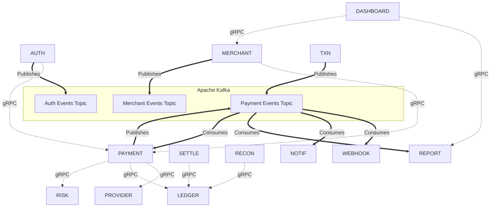
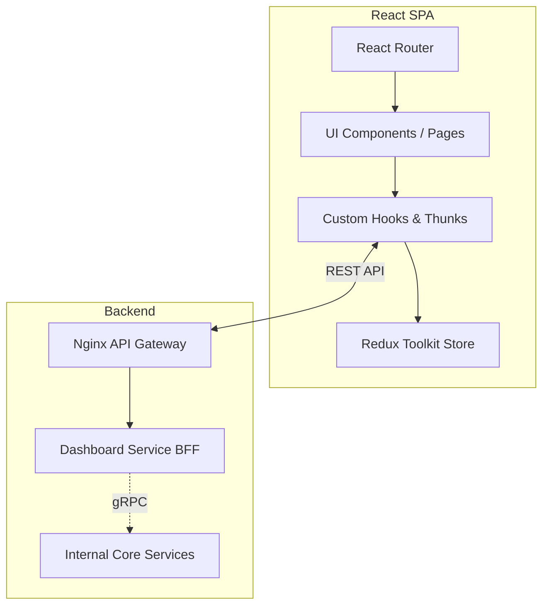

# Enterprise Payment Gateway


An enterprise-grade, highly resilient payment gateway designed for high-throughput financial transactions. This system is built on a polyglot microservice architecture featuring strictly consistent double-entry accounting, Zero-Trust network security, and asynchronous Kafka-based state orchestration to protect against external provider unreliability.

---

## 🏗 System Architecture Overview

The system is composed of **20 isolated microservices** routed through an Nginx Gateway. It is split into three technology stacks based on operational requirements: **Go** for high-performance financial core logic, **TypeScript/Express** for business management, and **Python** for machine learning inference.

```mermaid
flowchart TD
    CLIENTS[Clients / Merchants]
    GATEWAY[Nginx API Gateway]
    
    CLIENTS --> GATEWAY

    subgraph TS_Services ["Express/TypeScript Services (Business Layer)"]
        AUTH[Auth Service]
        MERCHANT[Merchant Service]
        ADMIN[Admin Service]
        DASHBOARD[Dashboard BFF]
        NOTIF[Notification Service]
        REPORT[Reporting Service]
        COMPLIANCE[Compliance Worker]
    end

    subgraph Go_Services ["Go Services (Financial Core)"]
        PAYMENT[Payment Service]
        PROVIDER[Provider Service]
        LEDGER[Ledger Service]
        TXN[Transaction Service]
        WEBHOOK[Webhook Service]
        RECON[Reconciliation Service]
        SETTLE[Settlement Service]
        RISK[Risk Service]
        ROUTING[Routing Service]
        PRICING[Pricing Service]
        DISPUTE[Dispute Service]
        FX[FX Service]
    end

    subgraph Python_Services ["Python Services (ML Layer)"]
        ML[Risk ML Worker]
    end

    GATEWAY --> AUTH
    GATEWAY --> MERCHANT
    GATEWAY --> PAYMENT
    GATEWAY --> TXN
    GATEWAY --> DASHBOARD
    GATEWAY --> ADMIN

    %% External Systems
    PROVIDER_EXT[External Providers e.g. Telebirr, CBE]
    PROVIDER <-->|API Calls| PROVIDER_EXT
    PROVIDER_EXT -->|Async Webhooks| TXN
```



### Technology Stack
*   **API Gateway**: Nginx 
*   **Business Services**: Node.js, Express, TypeScript, Prisma ORM
*   **Financial Core**: Go, gRPC, GORM
*   **Machine Learning**: Python, FastAPI/gRPC, scikit-learn
*   **Databases**: PostgreSQL (Microservice Database-per-service pattern)
*   **Message Broker**: Apache Kafka (Event-driven architecture & Outbox pattern)
*   **Caching**: Redis
*   **Observability**: OpenTelemetry, Prometheus, Grafana

---

## 🔄 Service-to-Service Communication

The gateway relies on two distinct communication patterns:
1.  **Synchronous (gRPC)**: For operations requiring immediate consistency (e.g., deducting limits, writing to the Ledger, checking risk rules).
2.  **Asynchronous (Kafka)**: For event broadcasting, long-running processes, and orchestrator loops.



---

## 💾 Database Architecture (Isolated Micro-Databases)

The system utilizes 20 isolated PostgreSQL schemas. **Each service completely owns its data** and no cross-database JOINs are permitted. Data replication and references are handled logically.

```mermaid
erDiagram
    "AUTH_DB" ||--o{ "Users" : manages
    "AUTH_DB" ||--o{ "Roles (RBAC)" : manages
    "AUTH_DB" ||--o{ "AuditLogs" : manages

    "MERCHANT_DB" ||--o{ "Merchants" : manages
    "MERCHANT_DB" ||--o{ "ApiKeys" : manages
    "MERCHANT_DB" ||--o{ "Limits & Prefs" : manages

    "PAYMENT_DB" ||--o{ "Payments" : manages
    "PAYMENT_DB" ||--o{ "Refunds" : manages
    "PAYMENT_DB" ||--o{ "PaymentStateHistory" : manages

    "LEDGER_DB" ||--o{ "JournalEntries" : manages
    "LEDGER_DB" ||--o{ "JournalLines" : manages
    "LEDGER_DB" ||--o{ "Accounts" : manages

    "TRANSACTION_DB" ||--o{ "ProviderWebhooks" : handles

    "WEBHOOK_DB" ||--o{ "Deliveries" : dispatches
    "WEBHOOK_DB" ||--o{ "Attempts" : tracks

    "ADMIN_DB" ||--o{ "PaymentProviders" : registers
    
    "RISK_DB" ||--o{ "FraudRules" : enforces
    "COMPLIANCE_DB" ||--o{ "KYC_Records" : tracks
    "PRICING_DB" ||--o{ "FeeSchedules" : calculates
    "ROUTING_DB" ||--o{ "RoutingRules" : determines
    "DISPUTE_DB" ||--o{ "Chargebacks" : manages
    "FX_DB" ||--o{ "ExchangeRates" : converts
```



### Key Schemas Detailed:
*   **`payment_db`**: Owns financial intent. Uses Optimistic Concurrency Control (OCC). Contains `Payments`, `Refunds`, `PaymentStateHistory`, and `IdempotencyKeys`.
*   **`ledger_db`**: The ultimate source of truth. Uses immutable **Double-Entry Accounting**. Entries can never be deleted or modified, only reversed.
*   **`merchant_db`**: Contains `Merchants`, `ApiKeys` (hashed), `WebhookConfigs`, `ProviderConfigs`, and detailed `MerchantPreferences` and `MerchantPaymentMethods`.
*   **`auth_db`**: Contains `Users`, `Credentials` (hashed), `Roles` (RBAC), and system-wide `AuditLogs`.
*   **`webhook_db`**: Handles outgoing webhooks to merchants. Uses `Deliveries` and `Attempts` tables to track exponential backoff and retries.

---

## 🛡 Security & Zero-Trust (mTLS & SPIFFE)

The system assumes the internal network is compromised and operates on a strict **Zero-Trust** model.
*   **mTLS Everywhere**: Every internal gRPC and Kafka connection requires a valid X.509 client certificate.
*   **SPIFFE Identity**: Certificates embed the service's identity in the Subject Alternative Name (e.g., `spiffe://payment-gateway/ns/production/sa/payment-service`).
*   **gRPC Authorization Matrix**: A universal `UnaryServerInterceptor` blocks requests (with `PERMISSION_DENIED`) if the calling service is not explicitly allowed to execute a specific RPC method. For example, `reporting-service` cannot spoof a call to the `ledger-service`.
*   **Kafka ACLs**: Services can only publish/consume from topics they are cryptographically authorized to access.
*   **Context Anti-Spoofing**: Enforced checks to ensure a compromised service cannot impersonate another service's identity in logs or tracing contexts.

---

## ⚙️ Core Engineering Principles

### 1. No Silent Fallbacks (Explicit State Modeling)
Payments do not simply transition from `PENDING -> COMPLETED`. External networks fail. The system explicitly models uncertainty:
*   `UNKNOWN`: Provider timed out. Requires manual/automated reconciliation.
*   `COMPLETION_PENDING`: Provider succeeded, but the internal Ledger failed to post.
Every single transition is permanently appended to `payment_state_history` to ensure a perfect audit trail.

### 2. The Asynchronous Orchestrator Loop
To protect the system from out-of-order webhooks and provider unreliability:
1.  **Payment Service** initiates a payment, saves state as `PENDING`, and halts.
2.  **Transaction Service** (exclusively) receives the async webhook from the provider (e.g., Telebirr/M-Pesa), deduplicates it using Postgres `UNIQUE` constraints, and publishes an Outbox event to Kafka.
3.  **Payment Service** consumes the Kafka event, records the final `JournalEntry` to the Ledger, and updates the payment to `SUCCEEDED`.

### 3. Exactly-Once Processing (Idempotency)
All external-facing APIs and internal message consumers utilize strict Idempotency Keys and `ProcessedEvent` tables to ensure network retries never result in double-charging or double-crediting.

---

## 👥 Roles & Access Control

The `auth-service` manages a full Role-Based Access Control (RBAC) system:
*   `SUPER_ADMIN`: Global system administration.
*   `MERCHANT_OWNER`: Full access to a specific merchant's organization.
*   `MERCHANT_DEVELOPER`: Access to API keys and webhook logs.
*   `MERCHANT_FINANCE`: Access to reporting, balances, and reconciliation.

**API Authentication**: 
Incoming requests to the Payment Gateway require either a `SECRET` key (backend-to-backend) or a `PUBLISHABLE` key (frontend/checkout).

---

## 🚀 Key Endpoints (High-Level)

### Payment API
*   `POST /v1/payments` - Initiate a payment (Idempotent)
*   `GET /v1/payments/:id` - Check payment status
*   `POST /v1/payments/:id/refund` - Initiate a partial/full refund

### Merchant API 
*   `POST /v1/merchants/api-keys` - Generate a new secret key
*   `POST /v1/merchants/webhooks` - Configure webhook endpoints
*   `PATCH /v1/merchants/preferences` - Update routing and fee settings

### Webhook & Event Dispatch
*   **Ingestion**: External providers send data to `/v1/transactions/callback/:provider`
*   **Dispatch**: `webhook-service` pushes securely to the Merchant's configured endpoints.

### Internal RPCs (gRPC Only)
*   `ledger.LedgerService/RecordJournalEntry`
*   `provider.ProviderService/InitiatePayment`
*   `risk.RiskService/EvaluateRisk`

---

## 💻 Frontend Architecture (Dashboard)

The Merchant Dashboard is a Single Page Application (SPA) built to provide merchants with real-time insights, configuration management, and payment tracking. 

### Technology Stack
*   **Core**: React 19, TypeScript, Vite
*   **State Management**: Redux Toolkit (`@reduxjs/toolkit`)
*   **Routing**: React Router DOM
*   **Styling**: Pure/Vanilla CSS with `classnames`
*   **Icons**: Lucide React

### State & Data Flow

The frontend relies on a strictly unidirectional data flow. API requests are routed through the backend's Nginx Gateway, hitting the `dashboard-service` (BFF - Backend for Frontend), which acts as an aggregator for the internal microservices.



### Directory Structure (Feature-Sliced)

The codebase is organized into domain-driven feature modules and shared layers to ensure scalability as the dashboard grows:

```text
src/
 ├── components/  # Shared/reusable UI components (Buttons, Modals, Tables)
 ├── features/    # Domain-specific logic and isolated components (e.g., Auth, Payments)
 ├── pages/       # Route-level components mapping to views
 ├── layouts/     # Structural layouts (Sidebar, Header, Main Content area)
 ├── store/       # Redux Toolkit store configuration, slices, and selectors
 ├── services/    # API integration and data fetching logic
 ├── hooks/       # Custom React hooks (e.g., useAuth)
 └── utils/       # Helper functions and formatters (e.g., date-fns)
```

---

## ☁️ Cloud Architecture & Infrastructure Deployment

The platform is deployed in a multi-tier, zero-trust cloud architecture hosted on **Amazon Web Services (AWS)** in the **Stockholm (`eu-north-1`)** region, orchestrated via **Terraform (Infrastructure as Code)**.

| Component | Production Specification | Live Target / Endpoint |
| :--- | :--- | :--- |
| **Edge & Frontend** | Vercel Serverless Edge (Next.js/React SPA) | `https://easy-payment-gateway.vercel.app` |
| **Web Application Firewall** | AWS WAFv2 (Regional Web ACL) | `payment-gateway-staging-waf` |
| **Application Load Balancer** | AWS ALB (Multi-AZ Public Subnets) | `payment-gateway-staging-alb-1448992872.eu-north-1.elb.amazonaws.com` |
| **Compute Engine** | AWS ECS on Fargate (Serverless Containers) | `payment-gateway-staging-cluster` (16 Microservices) |
| **Service Discovery** | AWS Cloud Map Private DNS Namespace | `*.payment-gateway.internal` |
| **Relational Database** | Amazon RDS PostgreSQL (Multi-Schema) | `payment-gateway-staging-postgres.ct6easkiwemw.eu-north-1.rds.amazonaws.com:5432` |
| **In-Memory Cache & Locks**| Amazon ElastiCache Redis Cluster | `master.payment-gateway-staging-redis.pdpg9a.eun1.cache.amazonaws.com:6379` |
| **Carrier Outbound NAT** | AWS Elastic IP (Deterministic Egress) | `51.20.39.80` (Telebirr / CBE Birr allowlisted) |
| **Compliance Object Stores**| Amazon S3 (Encrypted via Customer KMS) | 4 Isolated Buckets (`kyc`, `disputes`, `settlement`, `audit`) |

---

### 🌐 AWS Deployed Architecture Topology

The live cloud infrastructure implements defense-in-depth isolation across three network tiers: Public Ingress, Private Application, and Private Data.


---

### 🛡️ Security Architecture & 4-Tier Zero-Trust Isolation

Network isolation is strictly governed by security group chaining where no database or core financial engine can be reached directly from the internet.

```text
[ Internet / Vercel ]
         │ (HTTPS 443)
         ▼
[ ALB Security Group: sg-086c409e4f03de11e ]
         │ (HTTP 8080 forward)
         ├───► [ Tier 1 Public SG: sg-0ff89d4a30b1b2335 ] (auth, payment, merchant, billing, dashboard)
         └───► [ Tier 2 Admin SG:  sg-0bc3c26295a622835 ] (admin-service)
                     │
                     │ (gRPC 50051-50058 / Cloud Map)
                     ▼
         [ Tier 3 Financial Core SG: sg-0d27af2e251e75575 ] (ledger, risk, provider, settlement, txn)
         [ Tier 4 Async Worker SG:   sg-0f70199c622dd39e2 ] (webhook, notification)
                     │
         ┌───────────┴───────────────────────┐
         │ (Port 5432)                       │ (Port 6379)
         ▼                                   ▼
[ RDS PostgreSQL SG: sg-0e0f637b8c339f790 ]  [ Redis ElastiCache SG: sg-0ead89f7f6d72894b ]
```

1. **WAF Protection (`payment-gateway-staging-waf`)**:
   - Inspects all traffic entering the ALB.
   - Enforces AWS Managed Common Rule Set (CRS), SQL Injection detection, Known Bad Inputs, and a rate-limit threshold of 2,000 requests per 5-minute window per IP.
2. **Tiered Network Isolation**:
   - **Tier 1 (Public Services)**: Only accepts inbound traffic on port `8080` from `alb_security_group`.
   - **Tier 2 (Admin API)**: Isolated security group restricted to admin path routing.
   - **Tier 3 (Core Financial Engine)**: Has **zero** ingress paths from the ALB. It exclusively accepts gRPC/HTTP requests originating from Tier 1 and Tier 2 security groups.
   - **Tier 4 (Async Workers)**: Internal consumers executing webhook delivery and notifications.
3. **Data Tier Ingress**:
   - `rds_security_group` allows inbound traffic on port `5432` **only** from the ECS task security groups (`Tier 1 - Tier 4`).
   - `redis_security_group` allows inbound traffic on port `6379` **only** from the ECS task security groups with required in-transit TLS and password authentication.
4. **AWS PrivateLink Endpoints**:
   - Dedicated VPC endpoints (`vpce-0de2eab1a77bc8b30`, `vpce-03e371516cd4b7fc4`, `vpce-0a6c74cc2e9ed9b73`, `vpce-02c8dfbb83d845977`) enable ECS tasks to pull ECR container images, stream CloudWatch logs, and retrieve secrets without traversing the public internet.

---

### 🗺️ Network & Subnet Allocation (VPC `10.20.0.0/16`)

The AWS VPC (`vpc-0f80380c03be17d3c`) spans two Availability Zones in `eu-north-1` (Stockholm):

| Subnet Type | CIDR Block | Availability Zone | Subnet ID | Deployed Workloads |
| :--- | :--- | :--- | :--- | :--- |
| **Public A** | `10.20.0.0/24` | `eu-north-1a` (`eun1-az1`) | `subnet-06530bc9522bdc06f` | ALB Primary, NAT Gateway (`51.20.39.80`) |
| **Public B** | `10.20.1.0/24` | `eu-north-1b` (`eun1-az2`) | `subnet-05878daa7174b910e` | ALB Secondary |
| **Private App A** | `10.20.10.0/24` | `eu-north-1a` (`eun1-az1`) | `subnet-02cc13deaa844777c` | ECS Fargate Microservices, VPC Endpoints |
| **Private App B** | `10.20.11.0/24` | `eu-north-1b` (`eun1-az2`) | `subnet-0779619888156c00a` | ECS Fargate Microservices, VPC Endpoints |
| **Private Data A**| `10.20.20.0/24` | `eu-north-1a` (`eun1-az1`) | `subnet-04ee165032c78e794` | RDS PostgreSQL, ElastiCache Redis Primary |
| **Private Data B**| `10.20.21.0/24` | `eu-north-1b` (`eun1-az2`) | `subnet-0a4518be691b0250c` | RDS PostgreSQL Standby, ElastiCache Replica |

> **Carrier White-listing Notice:** All outbound calls to external banking and telecommunications APIs (such as Telebirr B2B, CBE Birr, and Chapa) egress via the static Elastic IP **`51.20.39.80`** assigned to the VPC NAT Gateway, enabling deterministic IP whitelisting.

---

### 🚀 ECS Fargate Microservice Fleet & Service Discovery

All 16 backend microservices run as containerized tasks in the serverless ECS Cluster `payment-gateway-staging-cluster`. Internal inter-service communication resolves via **AWS Cloud Map** (`payment-gateway.internal`):

| Microservice | Tier | Container Port | Cloud Map Discovery Domain | ALB Routing Path |
| :--- | :---: | :---: | :--- | :--- |
| **`auth-service`** | Tier 1 | `8080` (HTTP) | `auth-service.payment-gateway.internal` | `/api/v1/auth*` |
| **`payment-service`** | Tier 1 | `8080` (HTTP) | `payment-service.payment-gateway.internal` | `/api/v1/payments*` |
| **`merchant-service`** | Tier 1 | `8080` (HTTP) | `merchant-service.payment-gateway.internal` | `/api/v1/merchants*` |
| **`billing-service`** | Tier 1 | `8080` (HTTP) | `billing-service.payment-gateway.internal` | `/api/v1/billing*` |
| **`dashboard-service`** | Tier 1 | `8080` (HTTP) | `dashboard-service.payment-gateway.internal` | `/api/v1/dashboard*` |
| **`reporting-service`** | Tier 1 | `8080` (HTTP) | `reporting-service.payment-gateway.internal` | `/api/v1/reporting*` |
| **`dispute-service`** | Tier 1 | `8080` (HTTP) | `dispute-service.payment-gateway.internal` | `/api/v1/disputes*` |
| **`reconciliation-service`**| Tier 1 | `8080` (HTTP) | `reconciliation-service.payment-gateway.internal`| `/api/v1/reconciliation*`|
| **`admin-service`** | Tier 2 | `8080` (HTTP) | `admin-service.payment-gateway.internal` | `/api/v1/admin*` |
| **`ledger-service`** | Tier 3 | `50051` (gRPC) | `ledger-service.payment-gateway.internal` | _Internal Only_ |
| **`risk-service`** | Tier 3 | `50052` (gRPC) | `risk-service.payment-gateway.internal` | _Internal Only_ |
| **`provider-service`** | Tier 3 | `50053` (gRPC) | `provider-service.payment-gateway.internal` | _Internal Only_ |
| **`settlement-service`** | Tier 3 | `50054` (gRPC) | `settlement-service.payment-gateway.internal` | _Internal Only_ |
| **`transaction-service`** | Tier 3 | `50056` (gRPC) | `transaction-service.payment-gateway.internal` | _Internal Only_ |
| **`notification-service`** | Tier 4 | `50055` (gRPC) | `notification-service.payment-gateway.internal` | _Internal Only_ |
| **`webhook-service`** | Tier 4 | `50057` (gRPC) | `webhook-service.payment-gateway.internal` | _Internal Only_ |

---

### 💾 Data Persistence, Caching & Compliance Storage

1. **Amazon RDS PostgreSQL 15**:
   - Endpoint: `payment-gateway-staging-postgres.ct6easkiwemw.eu-north-1.rds.amazonaws.com:5432`
   - Master credentials managed and rotated via AWS Secrets Manager (`arn:aws:secretsmanager:...:rds/master-credentials-6q6iYF`).
   - Encryption at rest backed by AWS KMS Key (`arn:aws:kms:...:key/7ce758aa-b4fc-4b1e-9aa5-f283ced521b8`).
   - Schemas are partitioned per service domain (`auth`, `payments`, `ledger`, `merchants`, `billing`, `risk`, etc.).
2. **Amazon ElastiCache for Redis**:
   - Primary: `master.payment-gateway-staging-redis.pdpg9a.eun1.cache.amazonaws.com:6379`
   - Replica: `replica.payment-gateway-staging-redis.pdpg9a.eun1.cache.amazonaws.com:6379`
   - Used for distributed idempotency tokens (`Idempotency-Key` headers), transaction state locks, and session caching.
   - Secured with in-transit TLS encryption and auth token stored in Secrets Manager.
3. **Compliance & Audit S3 Storage (SSE-KMS Encrypted)**:
   - `payment-gateway-staging-kyc-docs-rulo18`: Merchant verification documents, business licenses, and ID records.
   - `payment-gateway-staging-dispute-evidence-rulo18`: Chargeback evidence, customer receipts, and communications.
   - `payment-gateway-staging-settlement-statements-rulo18`: Daily batches, merchant payout statements, and clearing files.
   - `payment-gateway-staging-audit-reports-rulo18`: Immutable double-entry financial audit logs and reconciliation summaries.

---

### 🛠️ Infrastructure as Code (Terraform) Structure

All AWS resources are codified and maintained under `infra/terraform/`:

```text
infra/terraform/
├── bootstrap/                   # S3 Remote State Bucket & DynamoDB Lock Table
└── environments/
    └── staging/
        ├── main.tf              # Module orchestrations (VPC, Security, ALB, ECS, RDS, S3)
        ├── variables.tf         # Staging environment variables and CIDR definitions
        ├── outputs.tf           # Exported ARNs, DNS endpoints, and security group IDs
        └── terraform.tfstate    # Remote managed state file
```

#### Deploying or Updating Infrastructure

```bash
# 1. Navigate to the environment directory
cd infra/terraform/environments/staging

# 2. Initialize modules and remote backend
terraform init

# 3. Inspect proposed infrastructure changes
terraform plan

# 4. Apply changes to AWS eu-north-1
terraform apply
```

---

### 💻 Local Development (Docker Compose)

For local development without cloud dependencies, the entire ecosystem can be run locally using Docker Compose:

```bash
# Start the entire local microservice ecosystem
make dev

# Or using docker compose directly
docker compose up -d
```

*   **PostgreSQL**: Container hosting 20 isolated schemas simulating the production RDS database.
*   **Apache Kafka & Zookeeper**: Local broker initialized with payment event topics (`payment.events`, `merchant.events`, `ledger.events`).
*   **Redis**: Local cache enforcing idempotency keys and distributed state.
*   **MailHog**: In-memory SMTP mail trap running at `http://localhost:8025` for notification testing.

