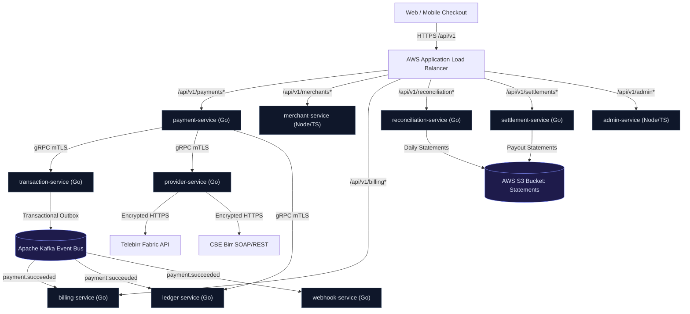
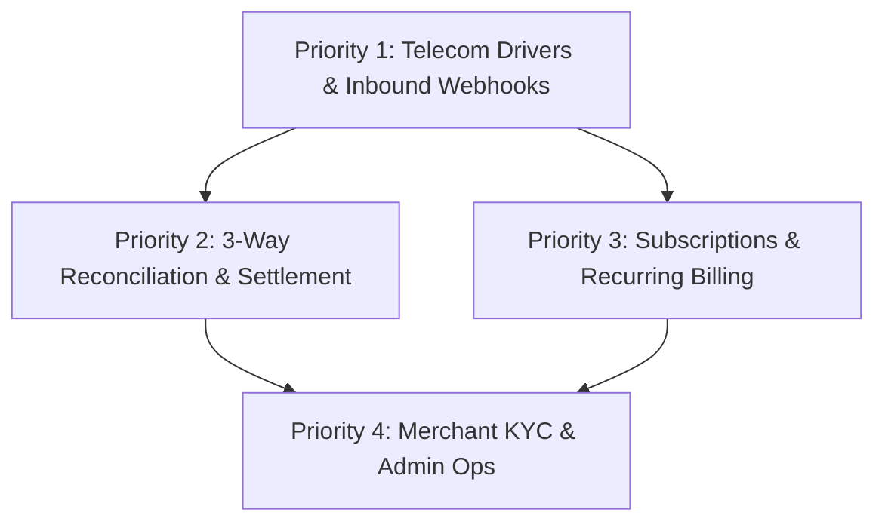

# Master Backend Execution Plan (Tier-1 Gateway Standards)

This document establishes the overarching architecture, sequencing, and operational milestones for transitioning the Payment Gateway from deployed infrastructure baseline to full production transaction volume, financial settlement integrity, and telecom carrier integration.

---

## 1. Executive Summary & Architectural Scope

The platform operates as a distributed microservices fleet orchestrated via AWS ECS Fargate, AWS ALB, Amazon Aurora PostgreSQL, and Redis clusters. Having finalized CI/CD automated deployment and basic core flows, the backend must now fulfill four mission-critical pillars:

---

## 2. The Four Implementation Priorities

| Priority | Focus Area | Primary Services Involved | Target Outcome |
| :--- | :--- | :--- | :--- |
| **Priority 1** | **Real Telecom Drivers & Webhooks** | `provider-service`, `transaction-service`, `webhook-service` | Production-grade Telebirr (H5/B2B RSA/AES) & CBE Birr driver execution, HMAC signature verification, and idempotent async callback ingestion. |
| **Priority 2** | **Automated Settlement & 3-Way Reconciliation** | `reconciliation-service`, `settlement-service`, `ledger-service` | Ingestion of MT940/CSV bank clearing records, automated 3-way reconciliation, net merchant payout calculation, and encrypted S3 statement generation. |
| **Priority 3** | **Subscriptions & Autonomous Recurring Billing** | `billing-service`, `payment-service`, `notification-service` | Subscription plan lifecycle, automated cron billing daemon, smart dunning retry backoff, and invoice PDF compilation. |
| **Priority 4** | **Merchant KYC, API Keys & Admin Controls** | `merchant-service`, `admin-service`, `auth-service` | Live/Test API key rotation, merchant KYC document review pipeline, fee schedules, and tenant ledger freeze capabilities. |

---

## 3. Execution Sequencing & Dependency Graph

1. **Phase 1 (Priority 1) must precede Phase 2 & 3**: Real financial flows, telecom transaction IDs, and cryptographic webhook callbacks are prerequisites for generating external bank records and triggering recurring charges.
2. **Phase 2 (Settlement) & Phase 3 (Billing) can be implemented in parallel**: Both leverage the transactional foundation built in Phase 1 and update `ledger-service`.
3. **Phase 4 (Merchant & Admin Controls) binds the business operations**: Exposes fee schedules, payout visibility, KYC gating, and provider route toggles to merchants and platform administrators.

---

## 4. Cross-Cutting Engineering Standards

1. **Financial Precision**:
   - All amounts are stored as 64-bit integer minor currency units (cents/cents-equivalent, e.g., 100 ETB = `10000`).
   - Floating-point calculations are strictly prohibited in financial math paths.
2. **Double-Entry Ledger Integrity**:
   - Zero net-balance invariant: $\sum \text{Debits} - \sum \text{Credits} = 0$ for every single transaction entry.
   - Immutable audit logs; no transaction or ledger record may ever be updated or deleted (`UPDATE`/`DELETE` restricted).
3. **Idempotency & Deduplication**:
   - All write endpoints accept an `Idempotency-Key` header stored in Redis with atomic `SETNX` (24-hour TTL) and PostgreSQL unique constraints.
4. **Resilience & Fault Tolerance**:
   - All external HTTP calls to telecom telcos (Telebirr/CBE) must employ exponential backoff with jitter and circuit-breaking.

---

## 5. Detailed Milestone Documents

The in-depth implementation blueprints for each priority are detailed in dedicated sub-plans:
- [01_telecom_drivers_and_webhooks.md](file:///home/mamush/Desktop/project/master-project/payment-gateway/docs/plans/01_telecom_drivers_and_webhooks.md)
- [02_settlement_and_reconciliation.md](file:///home/mamush/Desktop/project/master-project/payment-gateway/docs/plans/02_settlement_and_reconciliation.md)
- [03_subscriptions_and_recurring_billing.md](file:///home/mamush/Desktop/project/master-project/payment-gateway/docs/plans/03_subscriptions_and_recurring_billing.md)
- [04_merchant_kyc_and_admin_controls.md](file:///home/mamush/Desktop/project/master-project/payment-gateway/docs/plans/04_merchant_kyc_and_admin_controls.md)
