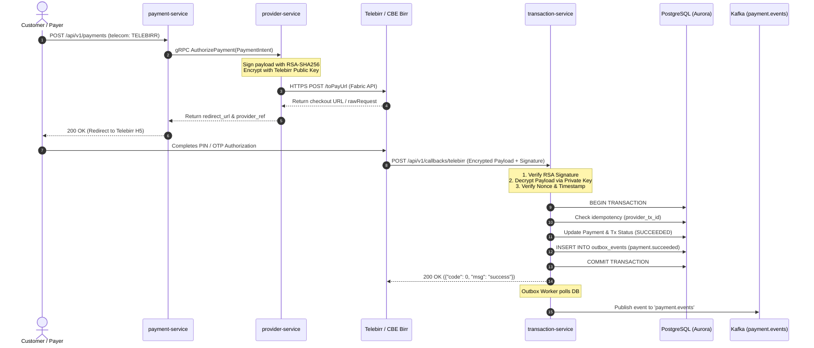

# Priority 1: Real Telecom Drivers & Webhook Ingestion Plan

This document details the engineering specifications for production telecom driver adapters (`services/provider-service`) and cryptographic callback ingestion (`services/transaction-service`).

---

## 1. Architecture & Flow Overview



---

## 2. Telebirr Fabric Driver Implementation (`provider-service`)

### 2.1 Cryptographic & Security Specifications
- **Signature Algorithm**: `SHA256withRSA` using merchant private key (PKCS#1 / PKCS#8).
- **Encryption Algorithm**: `AES-128-CBC` or `AES-256-CBC` with PKCS#5/PKCS#7 padding.
- **Key Exchange**: Dynamic AES session key encrypted with Telebirr's RSA Public Key and attached in HTTP header `X-Session-Key`.
- **String to Sign**: Deterministic alphabetical parameter sorting (`k1=v1&k2=v2...`).

### 2.2 Payload Contracts
#### Request Envelope
```json
{
  "appId": "APP_ID_123456",
  "nonceStr": "c5f87b89d97a4a2b9187e148e6c7104b",
  "timestamp": "1729000000",
  "signType": "SHA256withRSA",
  "sign": "BASE64_RSA_SIGNATURE_STRING",
  "bizContent": {
    "outTradeNo": "01a13f2b-21d9-75f7-b5e3-6609eed0c739",
    "subject": "Order Payment",
    "totalAmount": "100.00",
    "currency": "ETB",
    "notifyUrl": "https://easy-payment-gateway.vercel.app/api/v1/callbacks/telebirr",
    "returnUrl": "https://easy-payment-gateway.vercel.app/payment/success",
    "shortCode": "100123",
    "timeoutExpress": "30m"
  }
}
```

### 2.3 Implementation Targets in Codebase
- File: [`services/provider-service/internal/integration/telebirr.go`](file:///home/mamush/Desktop/project/master-project/payment-gateway/services/provider-service/internal/integration/telebirr.go)
  - `GenerateSignature(params map[string]interface{}, privKey *rsa.PrivateKey) (string, error)`
  - `EncryptPayload(plaintext []byte, pubKey *rsa.PublicKey) ([]byte, error)`
  - `CreateH5Order(ctx context.Context, req domain.PaymentRequest) (*domain.ProviderResponse, error)`
  - `QueryOrderStatus(ctx context.Context, providerTxID string) (*domain.ProviderResponse, error)`

---

## 3. CBE Birr Driver Implementation (`provider-service`)

### 3.1 Driver Mechanics
- **Channel**: CBE Birr REST/SOAP Ingress.
- **Initiation Mode**: Merchant-initiated USSD push to customer mobile number (`2519XXXXXXXX`).
- **Authorization Flow**: Customer receives USSD prompt on phone: *"Authorize payment of 100 ETB to Merchant X? Enter PIN"*.
- **Timeout & Status Polling**:
  - In addition to callback webhooks, `provider-service` implements an active polling worker with exponential backoff:
  - Intervals: Check after 5s, 10s, 20s, 40s until customer confirms or 60s timeout occurs.

### 3.2 Implementation Targets in Codebase
- File: [`services/provider-service/internal/integration/cbebirr.go`](file:///home/mamush/Desktop/project/master-project/payment-gateway/services/provider-service/internal/integration/cbebirr.go)
  - `InitiateCbePush(ctx context.Context, req domain.PaymentRequest) (*domain.ProviderResponse, error)`
  - `VerifyCbeSignature(body []byte, signature string) bool`

---

## 4. Inbound Webhook Callback Ingestion Engine (`transaction-service`)

### 4.1 Ingress Endpoints
1. `POST /api/v1/callbacks/telebirr`
2. `POST /api/v1/callbacks/cbebirr`

### 4.2 Security Gating & Signature Verification
1. **Raw Body Capture**: Middleware reads and preserves the unparsed request body for cryptographic signature verification.
2. **Signature Check**:
   ```go
   valid := VerifySha256WithRsa(rawBody, headerSignature, telebirrPublicKey)
   if !valid {
       return c.Status(401).JSON(fiber.Map{"error": "invalid cryptographic callback signature"})
   }
   ```
3. **Replay Protection**:
   - Verify timestamp is within $\pm 300$ seconds of current server UTC time.
   - Nonce validation cached in Redis (`EXISTS nonce:<val>` $\rightarrow$ reject if seen).

### 4.3 Atomic Idempotency & Transactional Outbox
To guarantee zero double-crediting or lost events under high concurrency:
```sql
BEGIN;

-- 1. Lock payment record with pessimistic row lock
SELECT status FROM payments WHERE id = $1 FOR UPDATE;

-- 2. Validate state transition
-- Only transitions from PENDING -> SUCCEEDED or PENDING -> FAILED are permitted.
UPDATE payments 
SET status = 'SUCCEEDED', 
    provider_transaction_id = $2, 
    updated_at = NOW() 
WHERE id = $1 AND status = 'PENDING';

-- 3. Insert into outbox within the EXACT SAME database transaction
INSERT INTO outbox_events (
    id, aggregate_type, aggregate_id, event_type, payload, status, created_at
) VALUES (
    gen_random_uuid(), 'PAYMENT', $1, 'payment.succeeded', $3, 'PENDING', NOW()
);

COMMIT;
```

---

## 5. Verification & Acceptance Criteria
- [ ] Unit tests for RSA-SHA256 signature generation and verification.
- [ ] Mock telecom sandbox responding to H5 and USSD Push scenarios.
- [ ] Webhook callback with tampered payload returns `HTTP 401 Unauthorized`.
- [ ] Duplicate callback invocation returns `HTTP 200 OK` without creating duplicate ledger or outbox entries.
- [ ] Outbox relay worker verifies event emission to Kafka `payment.events` topic within $<500\text{ms}$.
