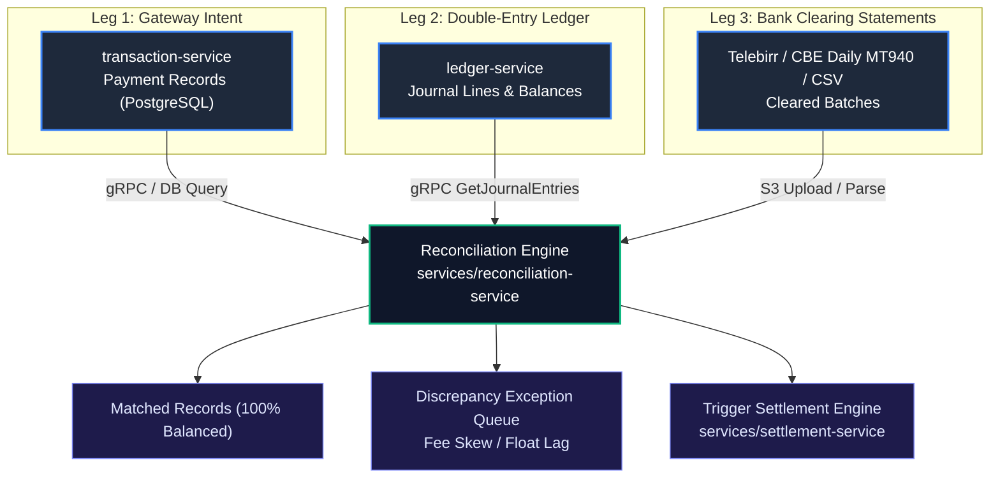
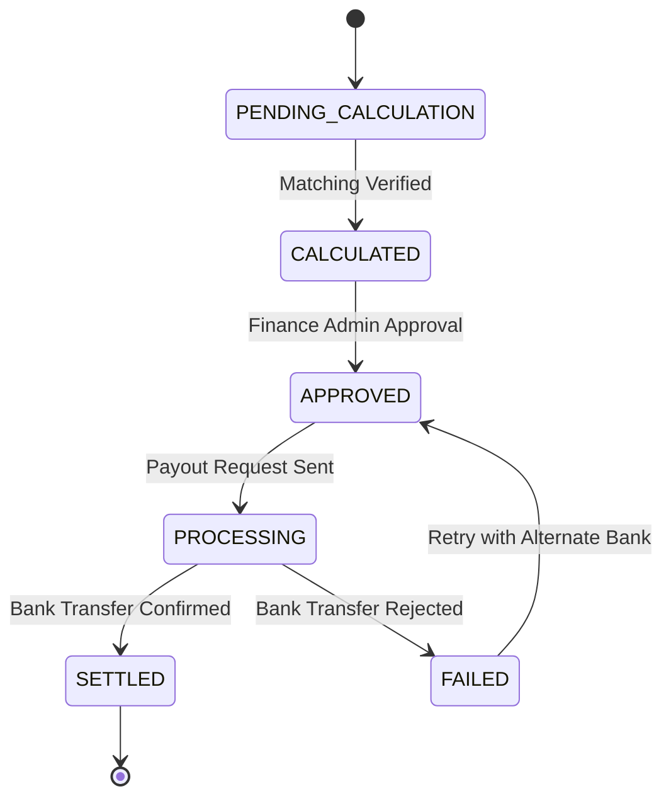

# Priority 2: Automated Settlement & 3-Way Reconciliation Plan

This document details the architecture and mathematical models for financial clearing, 3-way reconciliation (`services/reconciliation-service`), and merchant payout automation (`services/settlement-service`).

---

## 1. The 3-Way Reconciliation Architecture

---

## 2. Ingestion & File Parsing (`reconciliation-service`)

### 2.1 Supported File Formats
1. **Telebirr Daily Clearing CSV**:
   - Header: `TransactionID,MerchantCode,CustomerPhone,Amount,Fee,NetAmount,Timestamp,Status`
2. **SWIFT MT940 Format**:
   - Standard bank clearing statement parser parsing `:61:` (Statement Line) and `:86:` (Information to Account Owner).
3. **CBE Settlement XML/CSV**:
   - Standard batch clearing exports.

### 2.2 Ingestion API
- `POST /api/v1/reconciliation/statements/upload`
  - Accepts multipart form data file.
  - Generates an ingestion batch ID (`batch_rec_XXXXXXXX`).
  - Saves raw file to AWS S3 (`s3://payment-gateway-staging-settlement-statements-rulo18/clearing-statements/`).
  - Spawns asynchronous reconciliation worker job.

---

## 3. Matching Engine & Variance Classification

### 3.1 Matching Invariants
Each transaction must satisfy the 3-Way equation:
$$\text{Gateway Amount} = \text{Ledger Entry Debit} = \text{Bank Cleared Amount}$$
$$\text{Gateway Calculated Fee} \approx \text{Bank Deducted Fee} \quad (\pm \epsilon_{\text{rounding}})$$

### 3.2 Variance Matrix & Resolution Actions

| Discrepancy Type | Condition | Root Cause | Automated / Manual Action |
| :--- | :--- | :--- | :--- |
| **`MATCHED`** | All 3 legs agree on amount, reference, and currency. | Normal clearing. | Cleared for settlement payout. |
| **`FEE_SKEW`** | Amounts match, but telecom fee differs by $> 0.01$ ETB. | Telecom tiered pricing update or tariff mismatch. | Adjust fee ledger account via `ADJUSTMENT` journal entry. |
| **`TIMING_FLOAT`** | Record in Gateway and Ledger, but missing in Bank statement. | Transaction completed after bank daily cut-off time (e.g. 23:59). | Rolled over to $T+1$ reconciliation window. |
| **`GHOST_SETTLEMENT`**| Record in Bank statement, but missing in Gateway. | Unregistered transaction or direct manual teller credit. | High-priority alert in Admin Dashboard (`UNMATCHED_BANK`). |
| **`AMOUNT_MISMATCH`** | References match, but amounts disagree. | Partial refund, telecom currency conversion, or system truncation. | Freeze record; require manual finance operator review. |

---

## 4. Merchant Settlement & Payout Engine (`settlement-service`)

### 4.1 Net Payout Formula
Settlement is calculated per merchant for each cycle ($T+1$ or $T+2$):

$$\text{Gross Settlement} = \sum_{i=1}^n \text{Successful Payments}_i$$
$$\text{Net Payout} = \text{Gross Settlement} - \text{Gateway Fees} - \text{Refunds} - \text{Dispute Holds} - \text{Rolling Reserve} + \text{Released Reserves}$$

Where:
- $\text{Rolling Reserve} = \text{Gross Settlement} \times \text{Reserve Rate}$ (e.g., $5\%$ held for 90 days for fraud mitigation).
- $\text{Released Reserves} = \text{Matured reserve funds from 90 days prior}$.

### 4.2 Settlement State Machine

### 4.3 Automated Statement Generation
1. **Format**: Comprehensive PDF statement & CSV export.
2. **Contents**:
   - Merchant ID, Business Name, Tax ID.
   - Settlement Period ($T$ to $T+N$).
   - Itemized transaction ledger (Gross, Platform Fee, VAT, Net).
   - Bank transfer payout reference.
3. **Storage**:
   - Encrypted upload to AWS S3 bucket `payment-gateway-staging-settlement-statements-rulo18`.
   - Pre-signed URL generated for merchant dashboard download (valid 1 hour).

---

## 5. Verification & Acceptance Criteria
- [ ] Parse MT940 and CSV statements containing 10,000+ line items in under 3 seconds.
- [ ] 3-Way matcher correctly flags `FEE_SKEW`, `TIMING_FLOAT`, and `AMOUNT_MISMATCH`.
- [ ] Ledger journal entries automatically created for rounding/fee variance adjustments.
- [ ] Automated settlement batch calculations match exact pen-and-paper financial formulas down to 0 minor units.
- [ ] Generated PDF settlement statements successfully uploaded and accessible via S3 presigned URLs.
