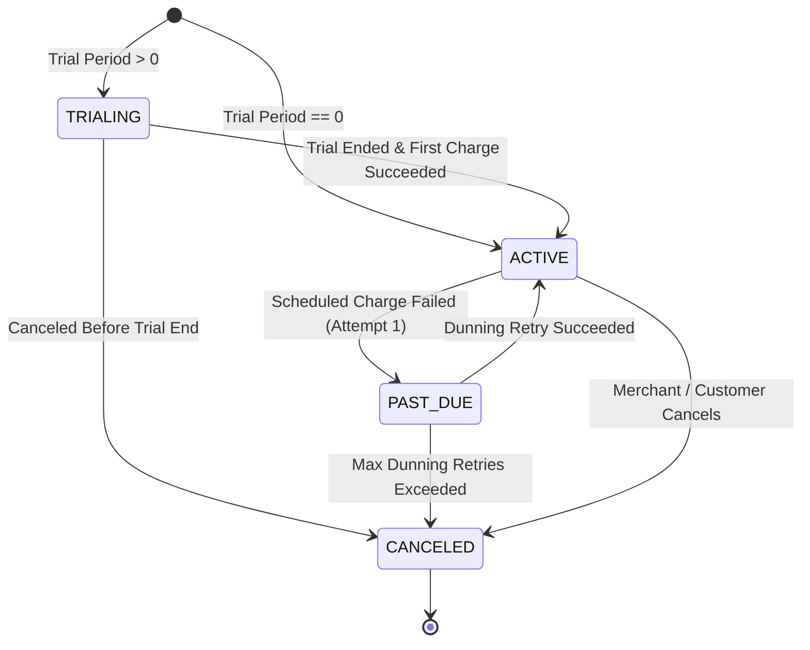
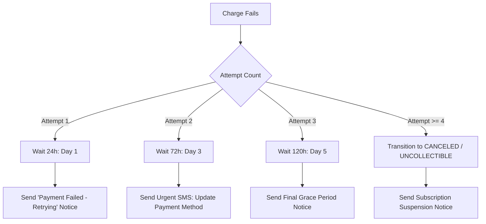

# Priority 3: Subscriptions & Autonomous Recurring Billing Plan

This document details the engineering specifications for the recurring revenue engine, automated subscription cron daemon, and smart dunning retry manager in [`services/billing-service`](file:///home/mamush/Desktop/project/master-project/payment-gateway/services/billing-service).

---

## 1. Subscription Lifecycle & State Machine



---

## 2. Core Domain Data Models

### 2.1 Subscription Plan (`subscription_plans`)
```sql
CREATE TABLE subscription_plans (
    id UUID PRIMARY KEY DEFAULT gen_random_uuid(),
    merchant_id UUID NOT NULL REFERENCES merchants(id),
    name VARCHAR(255) NOT NULL,
    description TEXT,
    amount BIGINT NOT NULL, -- Stored in minor currency units (cents)
    currency VARCHAR(3) NOT NULL DEFAULT 'ETB',
    billing_interval VARCHAR(20) NOT NULL, -- 'DAY', 'WEEK', 'MONTH', 'YEAR'
    interval_count INT NOT NULL DEFAULT 1,
    trial_period_days INT NOT NULL DEFAULT 0,
    is_active BOOLEAN NOT NULL DEFAULT true,
    created_at TIMESTAMPTZ NOT NULL DEFAULT NOW(),
    updated_at TIMESTAMPTZ NOT NULL DEFAULT NOW()
);
```

### 2.2 Customer Subscription (`subscriptions`)
```sql
CREATE TABLE subscriptions (
    id UUID PRIMARY KEY DEFAULT gen_random_uuid(),
    merchant_id UUID NOT NULL,
    customer_id VARCHAR(255) NOT NULL,
    plan_id UUID NOT NULL REFERENCES subscription_plans(id),
    payment_method_id VARCHAR(255) NOT NULL, -- Vaulted card token or telecom mandate
    status VARCHAR(50) NOT NULL DEFAULT 'ACTIVE', -- 'TRIALING', 'ACTIVE', 'PAST_DUE', 'CANCELED'
    current_period_start TIMESTAMPTZ NOT NULL,
    current_period_end TIMESTAMPTZ NOT NULL,
    next_billing_at TIMESTAMPTZ NOT NULL,
    cancel_at_period_end BOOLEAN NOT NULL DEFAULT false,
    canceled_at TIMESTAMPTZ,
    metadata JSONB,
    created_at TIMESTAMPTZ NOT NULL DEFAULT NOW(),
    updated_at TIMESTAMPTZ NOT NULL DEFAULT NOW()
);
CREATE INDEX idx_subscriptions_billing_due ON subscriptions (status, next_billing_at)
WHERE status IN ('ACTIVE', 'TRIALING', 'PAST_DUE');
```

### 2.3 Invoice Record (`invoices`)
```sql
CREATE TABLE invoices (
    id UUID PRIMARY KEY DEFAULT gen_random_uuid(),
    subscription_id UUID NOT NULL REFERENCES subscriptions(id),
    merchant_id UUID NOT NULL,
    customer_id VARCHAR(255) NOT NULL,
    amount_due BIGINT NOT NULL,
    amount_paid BIGINT NOT NULL DEFAULT 0,
    currency VARCHAR(3) NOT NULL DEFAULT 'ETB',
    attempt_count INT NOT NULL DEFAULT 0,
    status VARCHAR(50) NOT NULL DEFAULT 'DRAFT', -- 'DRAFT', 'OPEN', 'PAID', 'UNCOLLECTIBLE'
    payment_id UUID,
    paid_at TIMESTAMPTZ,
    next_retry_at TIMESTAMPTZ,
    created_at TIMESTAMPTZ NOT NULL DEFAULT NOW(),
    updated_at TIMESTAMPTZ NOT NULL DEFAULT NOW()
);
```

---

## 3. Autonomous Billing Scheduler & Concurrency Controls

### 3.1 Distributed Lock (Redis Mutex)
To ensure that multiple Fargate replicas do not double-bill subscriptions:
```go
// redsync mutex with a 5-minute lease and automatic renewal
mutex := redsyncPool.NewMutex("lock:billing-scheduler-cron", redsync.WithExpiry(5*time.Minute))
if err := mutex.Lock(); err != nil {
    log.Println("Another Fargate instance is executing billing cycle. Skipping.")
    return
}
defer mutex.Unlock()
```

### 3.2 Execution Loop
1. **Query**: Select subscriptions where `status IN ('ACTIVE', 'TRIALING') AND next_billing_at <= NOW()` with batch pagination limit of 100.
2. **Draft Invoice**: Create an `OPEN` invoice record.
3. **Dispatch Charge**: Call `payment-service` gRPC `CreatePayment`:
   - `Idempotency-Key`: `sub_charge_<subscription_id>_<period_end_timestamp>`
4. **On Success**:
   - Mark invoice as `PAID`.
   - Update `current_period_start = current_period_end`.
   - Update `current_period_end = current_period_end + interval`.
   - Update `next_billing_at = current_period_end`.
   - Emit `invoice.paid` event.

---

## 4. Smart Dunning Strategy & Retry Matrix

When a scheduled recurring charge fails (e.g. telecom wallet insufficient balance or expired card token):



### 4.1 Retry Formula
$$\Delta t_{\text{retry}} = \begin{cases} 
24 \text{ hours} & \text{for Attempt } 1 \\
48 \text{ hours} & \text{for Attempt } 2 \\
72 \text{ hours} & \text{for Attempt } 3 \\
\infty \text{ (Cancel)} & \text{for Attempt } \ge 4
\end{cases}$$

---

## 5. Verification & Acceptance Criteria
- [ ] Concurrency test: Multiple billing worker containers executing simultaneously never process the same subscription twice.
- [ ] Exact period rollovers (leap years, month-ends like Feb 28 to March 31 handled cleanly).
- [ ] Dunning engine correctly schedules and fires retries on Day 1, Day 3, and Day 5.
- [ ] Invoices automatically generated with correct itemized VAT/fees.
