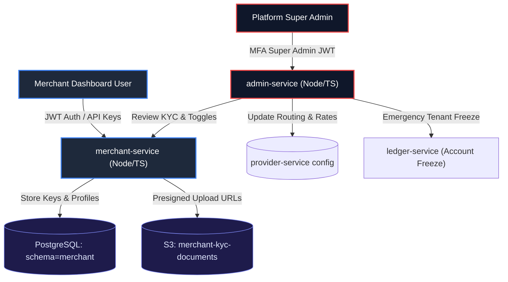
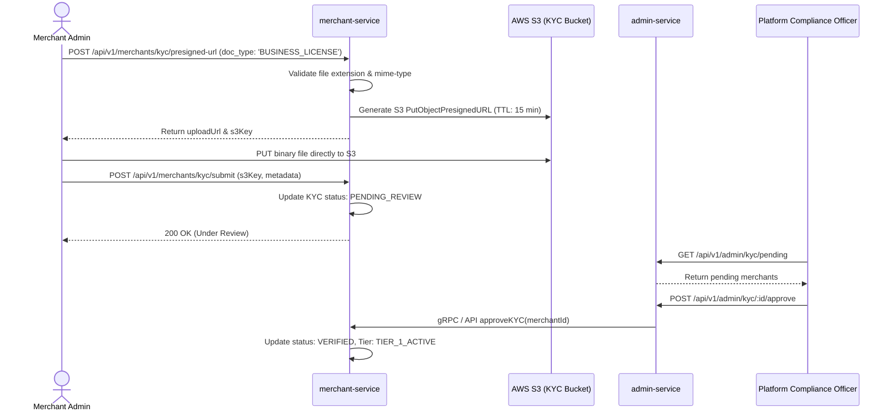

# Priority 4: Merchant KYC, API Keys & Admin Controls Plan

This document details the multi-tenant onboarding, cryptographic API key lifecycle, KYC document verification pipeline (`services/merchant-service`), and executive control plane (`services/admin-service`).

---

## 1. Multi-Tenant Architecture & Permissions Model



---

## 2. Cryptographic API Key Management (`merchant-service`)

### 2.1 Key Hierarchy & Formats
Each merchant possesses distinct keys for `TEST` (sandbox) and `LIVE` (production) environments:
- **Publishable Key**: `live_pub_<random_token>` / `test_pub_<random_token>`
  - Safe for public checkout pages, mobile SDKs, and payment buttons.
  - Scope: Restricted to initiating client sessions and tokenizing payment methods.
- **Secret Key**: `live_sec_<random_token>` / `test_sec_<random_token>`
  - Strictly restricted to secure merchant backend servers.
  - Scope: Authorizing charges, creating refunds, retrieving customer data.

### 2.2 Security Storage Model
- The raw secret key is **never stored in the database**.
- Upon generation, the secret key is displayed to the merchant **once**.
- Only the cryptographic hash (SHA-256 with key-stretching salt) and prefix (first 8 characters, e.g. `live_sec_...`) are retained for fast index lookups and verification.

```sql
CREATE TABLE merchant_api_keys (
    id UUID PRIMARY KEY DEFAULT gen_random_uuid(),
    merchant_id UUID NOT NULL REFERENCES merchants(id) ON DELETE CASCADE,
    name VARCHAR(100) NOT NULL,
    key_prefix VARCHAR(16) NOT NULL,
    key_hash VARCHAR(64) NOT NULL,
    environment VARCHAR(10) NOT NULL DEFAULT 'TEST', -- 'TEST' or 'LIVE'
    permissions TEXT[] NOT NULL DEFAULT '{"payments:read", "payments:write"}',
    last_used_at TIMESTAMPTZ,
    expires_at TIMESTAMPTZ,
    revoked_at TIMESTAMPTZ,
    created_at TIMESTAMPTZ NOT NULL DEFAULT NOW()
);
CREATE INDEX idx_merchant_api_keys_prefix ON merchant_api_keys(key_prefix) WHERE revoked_at IS NULL;
```

---

## 3. Merchant KYC Verification Pipeline

### 3.1 Document Upload Flow via Pre-signed S3 URLs
To prevent sensitive identity documents from loading into backend application memory:



### 3.2 KYC Verification Tiers
| Tier | Requirements | Limits |
| :--- | :--- | :--- |
| **Tier 0 (Sandbox)** | Email verified | Test mode only, 0 ETB volume. |
| **Tier 1 (Starter)** | National ID / Passport, Phone verified | Max 50,000 ETB / day. |
| **Tier 2 (Enterprise)**| Commercial Registration, TIN certificate, Bank statement | Unlimited volume, custom settlement schedules. |

---

## 4. Admin Control Plane (`admin-service`)

### 4.1 Merchant Provider Routing Overrides
Administrators can enable, disable, or prioritize providers per merchant:
- Example: Disable international card acquiring for high-risk merchants while keeping Telebirr and CBE enabled.
- Endpoints:
  - `GET /api/v1/admin/merchants/:id/providers`
  - `PUT /api/v1/admin/merchants/:id/providers` (Payload: `[{"provider": "TELEBIRR", "enabled": true, "priority": 1}]`)

### 4.2 Custom Fee Schedules
Override global platform fee defaults ($2.5\% + 2\text{ ETB}$) with negotiated contract rates:
```json
{
  "feeType": "PERCENTAGE_AND_FIXED",
  "percentageFee": 0.018, // 1.8%
  "fixedFee": 100,        // 1.00 ETB in minor units
  "minimumFee": 100,
  "maximumFee": 50000     // Cap fee at 500 ETB
}
```

### 4.3 Emergency Compliance Account Freeze
When suspicious activity or fraud spikes:
1. Compliance admin clicks **"Freeze Merchant"** in Admin Portal.
2. `admin-service` sends request to `merchant-service` and publishes `merchant.frozen` event.
3. `ledger-service` immediately updates account status to `FROZEN`:
   - Outbound payouts and settlements are halted instantly.
   - Payer checkout displays an informative hold status without leaking fraud indicators.

---

## 5. Verification & Acceptance Criteria
- [ ] Direct S3 upload verifies file size limits ($<10\text{MB}$) and valid MIME types (`image/jpeg`, `image/png`, `application/pdf`).
- [ ] API keys generated with high-entropy cryptographic CSPRNG; secret key never logged or recoverable.
- [ ] Super admin role enforcement: regular merchant tokens calling `/api/v1/admin/*` immediately receive `403 Forbidden`.
- [ ] Merchant account freeze instantaneously blocks settlement payout generation.
